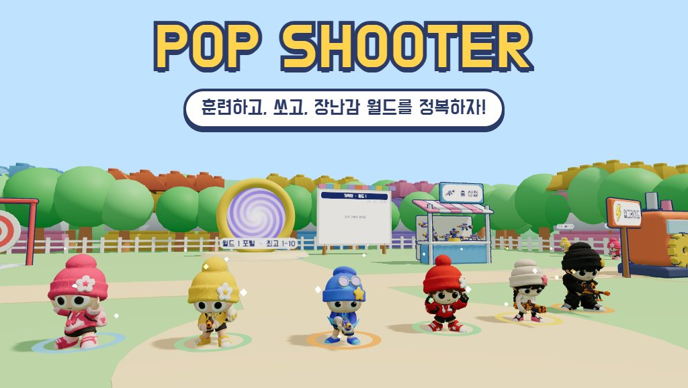
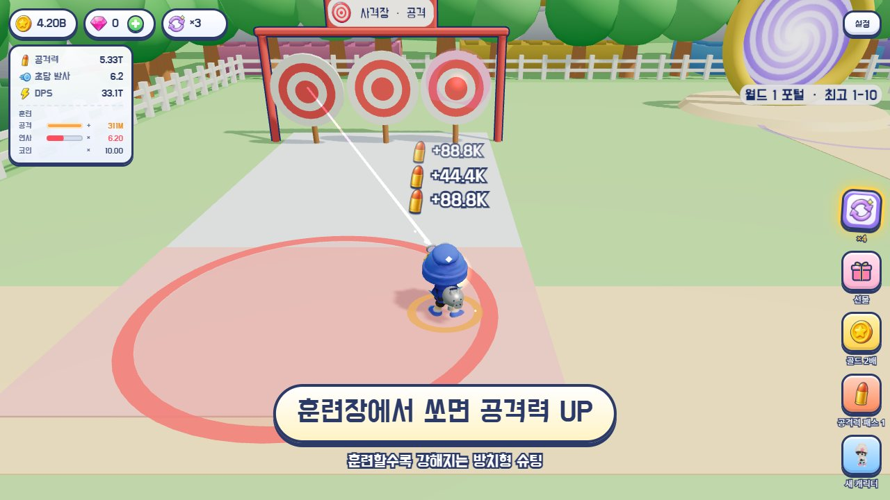
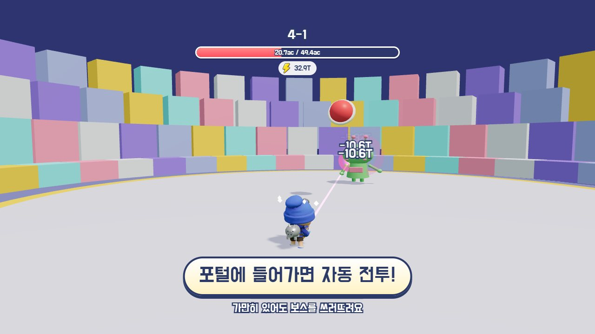
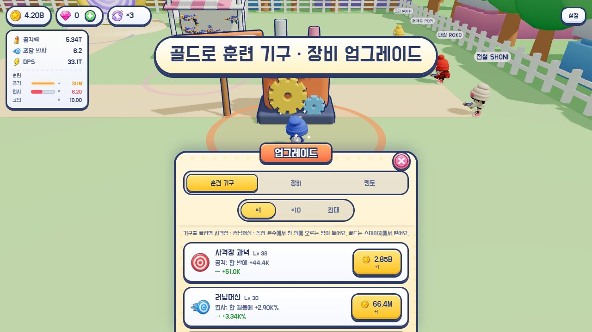
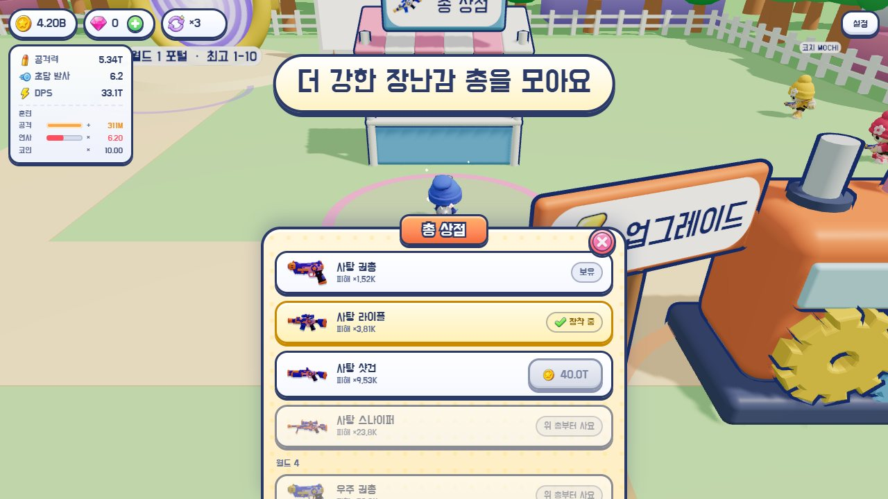
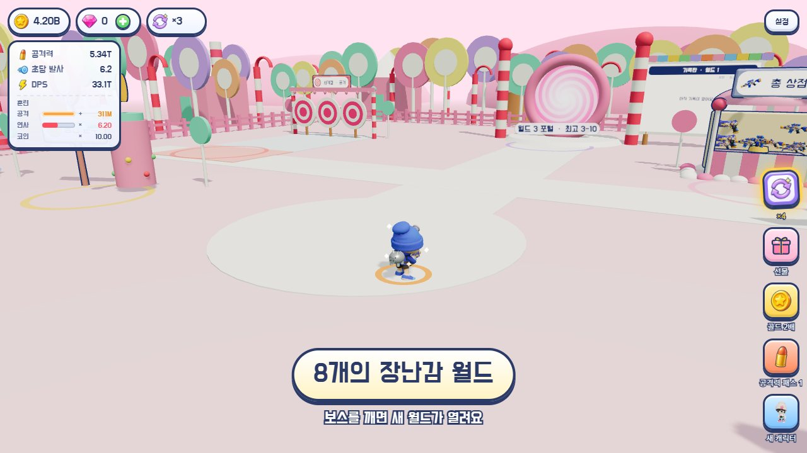
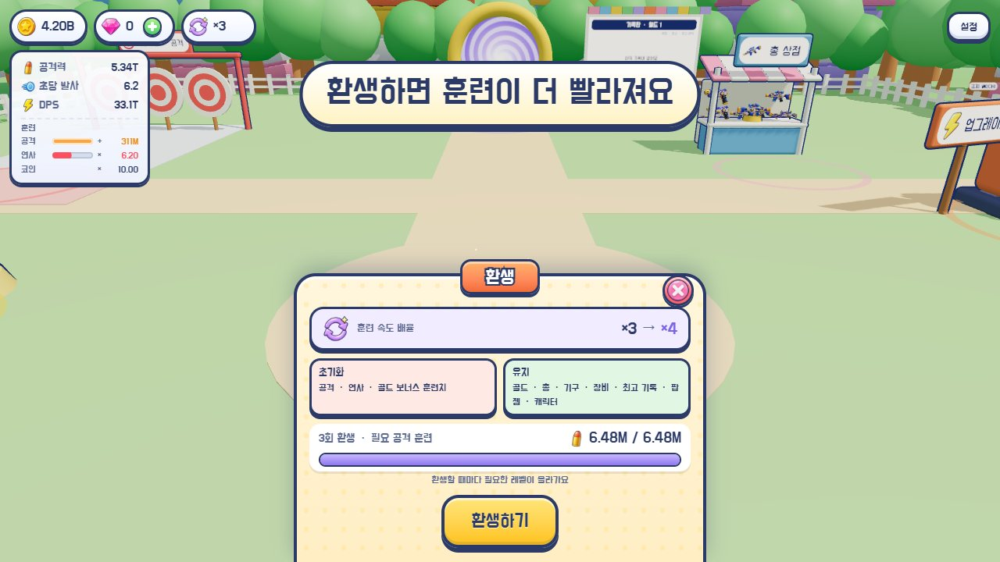
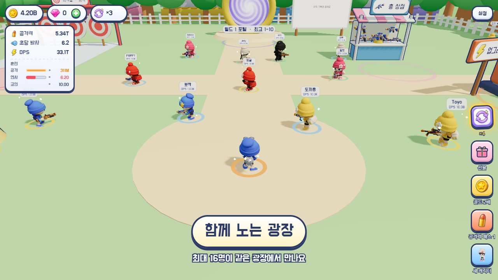
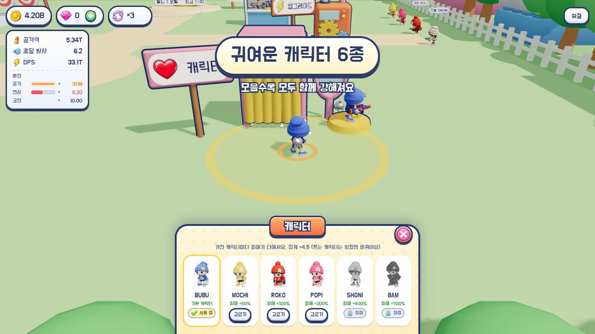

# POP Shooter

> 훈련하고, 쏘고, 장난감 월드를 정복하자! 방치형 성장 + 환생 슈팅.

장난감 캐릭터가 광장의 훈련 시설에서 강해지고, 포털에 들어가 점점 커지는 장난감 보스를 자동 전투로 쓰러뜨리며
8개의 월드를 넘어가는 방치형 성장 게임입니다. 막히면 환생해 영구 배율을 얻고 더 빠르게 다시 자랍니다.
Verse8(Agent8) 플랫폼에 배포했고, 설치 없이 PC·모바일 브라우저에서 돌아갑니다. 같은 광장에 있는 다른 플레이어가 보입니다.

**▶ 플레이: https://verse8.io/K8K5U7V**

| 플랫폼 | 상태 |
|---|---|
| Verse8 | 서비스 중 |
| 원스토어 | 출시 준비 |
| YouTube Playables | 출시 준비 |
| CrazyGames | 심사 중 |

<p>
  
</p>

<p>
  
  
</p>

## 어떤 게임인가

- **훈련:** 광장의 시설에 서 있기만 하면 훈련이 쌓입니다. 사격장(공격력), 러닝머신(연사), 동전 분수(골드 보너스).
  화면을 탭하면 추가 발사(초당 최대 8회 인정). 게임을 켜 두기만 해도, 꺼 두어도(최대 2시간 오프라인 보상) 자랍니다.
- **전투:** 포털에 들어가면 그 월드 1번부터 연속 도전. 조준·회피 없이 능력치(DPS)로 결과가 정해지고,
  지면 "DPS가 얼마 더 필요한지" 알려 줘서 다시 훈련하러 갑니다.
- **월드 8개 × 스테이지 10:** 월드마다 광장 꾸미기·하늘·배경음·전용 몹과 대장이 다릅니다. 대장을 처음 깨면 다음 월드 광장으로.
- **성장:** 골드로 훈련 기구·장비 업그레이드, 총 상점에서 더 강한 장난감 총 구매(총 모델이 바뀌어 강해진 게 보임),
  캐릭터 6종(모을수록 모두 함께 강해짐).
- **환생:** 공격 훈련치가 요구치를 넘으면 환생. 진행은 처음부터지만 훈련 속도 배율이 영구로 오릅니다.
- **함께 노는 광장:** 월드별 광장 방에 최대 16명. 전투·훈련은 혼자 하고, 광장에서는 서로 움직이고 훈련하는 모습이 보입니다.

<p>
  
  
</p>
<p>
  
  
</p>

## 주요 기능

**성장 루프**
- 광장 이동 → 훈련 → 골드 → 업그레이드·총 → 포털 보스 → 막히면 환생 → 영구 배율. 첫 1분 튜토리얼은 사격장 → 포털(첫 적까지 약 30초)
  → 첫 클리어 뒤 러닝머신 순서로 열리고, 막힌 포털 앞에서는 여는 조건을 한 줄로 알려 줍니다.
- 출석 보상(7일), 리워드 광고(골드 2배·보상 받기), 오프라인 보상 창.

**광장 멀티플레이**
- 위치 패킷(`[seq, t, x, z, yaw, vx, vz, bits]`)을 버퍼에 쌓아 보간해 그립니다. 비트에 걷기·사격장 사격·응원 상태.
- 러닝머신 위에서 패킷이 끊긴 사람(앱 백그라운드·화면 꺼짐, 그동안도 훈련은 쌓임)은 다른 화면에서 계속 달리는 자세로.
- 기록판(월드·스테이지 순위 상위 + 내 순위), 닉네임(금칙어·우회 표기 필터, 중복 방지).

**모바일**
- 화면 어디든 누르는 가상 조이스틱(마우스·터치 공통), PC는 WASD도. 시설은 들어가면 바로 동작하고 큰 버튼 하나로 씁니다.
- 멀리 있는 다른 플레이어는 가벼운 몸(약 7,600 → 2,200 삼각형)·저해상도 총으로, 장비와 그림자를 끔.

**운영 요소**
- 팝젬 단일 유료 화폐(VXShop 묶음 3종). 공격력 패스·유료 캐릭터·골드 부스트·환생 건너뛰기는 서버의 팝젬 상점에서.
- 5개 언어(English·한국어·日本語·繁體中文·简体中文), 그래픽·사운드 설정.
- 첫 로딩: 진행률 표시, GPU 예열(셰이더 미리 컴파일) 후 화면 공개.
- 광고·결제·저장·멀티를 플랫폼 어댑터(`src/platform/`) 뒤에 둬서 다른 스토어로 옮길 때 그 부분만 바꿉니다.

<p>
  
  
</p>

## 기술 스택

| 영역 | 사용 기술 |
|---|---|
| 클라이언트 | TypeScript(strict), Vite 8, three.js 0.186, DOM UI(HUD·패널) — 프레임워크 없이 바닐라 |
| 서버 | Verse8 Agent8 Game Server (`server/src/server.ts`: 원격 함수 · `$global` 사용자 상태/컬렉션 · `$lock` · 월드별 광장 룸) |
| 플랫폼 | `@agent8/gameserver`, `@verse8/platform`(VXShop), `@verse8/ads`(리워드 광고) |
| 테스트 | `node --test`(경제·훈련·저장 검사·이동 등 20개 파일), Agent8 서버 하네스(저장 검사·결제·랭킹·광장) |
| 밸런스 | 진행 시뮬레이터(`tools/sim/`): 목표 시간 → 스테이지 체력 표 역산 |
| 아트 | 캐릭터·총: POP! BATTLE 에셋 재사용(Codex 2D 레퍼런스 → Verse8 2D to 3D → GLB, Blender로 LOD·최적화), 맵 소품: Kenney 키트, 월드 몹·대장: 코드 도형 |

## 구조에서 신경 쓴 것

**저장은 서버가 검사**
진행 저장의 원본은 서버 계정 상태이고, 클라이언트가 보낸 저장은 서버 시각 기준 지난 시간으로 "그 사이 낼 수 있는 최대치"와 비교합니다
(`src/sim/econ.ts` `checkSave`). 훈련치는 그 시간에 쏠 수 있는 최대 발 수로 자르고, 새로 깬 스테이지는 그 DPS로 제한 시간 안에
깰 수 있어야 하며, 골드·레벨은 벌 수 있었던 골드를 넘으면 거절합니다. 첫 저장도 서버가 계정을 처음 본 시각의 새 판과 비교해
조작한 첫 저장으로 기록판·보상을 가져가지 못하게 했습니다. 팝젬·패스·유료 캐릭터는 서버 값만 씁니다.
같은 검사 코드를 클라이언트·서버·시뮬레이터가 공유합니다.

**오프라인 보상은 서버 시각**
기기 시계를 바꿔 오프라인 보상을 부풀릴 수 없게, 지난 시간은 항상 서버 시각으로 계산합니다. 서버에 연결 못 하면 기기 저장(계정별 키)으로 계속합니다.

**밸런스는 시뮬레이터로**
보스 체력을 지수 공식 하나로 두면 앞은 몇 분, 뒤는 수십 시간으로 벌어져 맞출 수 없었습니다. 그래서 "목표 시각 → 표"로,
스테이지마다 시뮬레이터 플레이어(효율이 가장 좋은 구매, 정체되면 환생)가 그 시각에 깰 수 있는 최대 체력을 이분 탐색합니다.
`node tools/sim/check.ts`로 월드 8 대장까지 막힘 없는지, 저장 검사에 걸리는 정상 플레이가 없는지(거절·자름 0건) 확인합니다.

**메모리를 고려한 렌더링·사운드**
- 반복 소품은 InstancedMesh, 이펙트 재질은 공유. 스킨 메시 복제는 뼈대 텍스처까지 해제.
- 배경음(월드 8곡 + 전투)은 디코드해 메모리에 올리지 않고 `<audio>` + `MediaElementAudioSourceNode`로 스트리밍, 짧은 효과음만 버퍼.
- 한글 폰트(Do Hyeon)는 자주 쓰는 글자 묶음과 나머지로 나눠(`tools/fonts/split_dohyeon.py`) 첫 화면에 필요한 것만 먼저 받습니다.

**에셋은 장면에서 검증**
장비(저금통·고글·장갑)는 뼈에 붙이는데, 기본 자세 몸 모양으로 위치를 잡으면 애니메이션 첫 프레임 뒤 떠 보여서
첫 애니메이션 자세 뒤에 붙입니다. 이런 문제는 개발 서버의 두 탭(두 계정)으로 재현해 스크린샷으로 확인했습니다.

## 실행

```bash
npm install
npm run dev               # http://localhost:5220
npm test                  # 경제·훈련·저장 검사 단위 테스트
npm run typecheck         # 클라이언트 타입 검사
npm run build             # 배포 빌드
npm run sim               # 진행 시뮬레이터 (탭 3회/초 기준 스테이지별 시간)
```

서버 (처음 한 번 `cd server && npm install --no-package-lock`):

```bash
npm run server:typecheck
cd server && npx -y @agent8/gameserver-node test
```

개발 서버는 `?account=<이름>`으로 시험 계정을 바꿔 두 탭에서 광장 멀티를 볼 수 있습니다. 콘솔 `__game`, `__hub`, `__battle`, `__training`.

## 폴더

```
src/
  core/         Game.ts(조립·메인 루프), 입력·조이스틱, 3D 스테이지, 구역 진입 연출, GPU 예열
  sim/          게임 규칙(순수 함수): 상태, 훈련, 전투, 스테이지 표, 저장 검사, 오프라인, 프리미엄
  training/     훈련 시설(사격장·러닝머신·동전 분수) 동작
  battle/       포털 안 자동 전투, 월드별 몹·대장(코드 도형)
  world/        월드별 광장(시설 몸체·꾸미기·하늘), 기록판, 멘토 NPC
  player/       아바타(애니메이션·IK·장비 부착·LOD), 캐릭터 외형
  net/          Agent8 연결, 광장 멀티(패킷 버퍼·다른 플레이어), 닉네임, 공용 코드(shared/)
  platform/     클라우드 저장, VXShop, 광고, 화면 켜짐 유지
  save/         기기 저장(계정별 키)과 서버 저장 고르기
  ui/           HUD, 패널(업그레이드·총·캐릭터·환생·상점·출석·설정·월드 이동), 결과 카드, 로딩
  audio/ fx/    사운드 매니저, 명중·구역 링·가림 반투명 효과
  i18n/         5개 언어 사전
server/src/     게임 서버 (저장 검사·출석·광고·팝젬 상점·결제·랭킹·광장·닉네임)
tests/          단위 테스트
tools/          진행 시뮬레이터, Blender(LOD·GLB 최적화), 폰트 분할, 오디오 변환, 스토어 캡처
docs/           기획서(superpowers/specs), VXShop 상품 목록, 스크린샷
public/         GLB(캐릭터·총·Kenney 키트), 배경음·효과음, UI 이미지, 폰트
```

## 라이선스·크레딧

- 맵 소품: [Kenney](https://kenney.nl) Brick Kit · Prototype Kit (CC0, `public/assets/kits/*/LICENSE-*.txt`)
- 폰트: Do Hyeon (SIL Open Font License, `public/fonts/DoHyeon-OFL.txt`)
- 배경음: Pixabay
- 캐릭터·총 모델과 게임 코드는 이 저장소 작성자의 것입니다.
